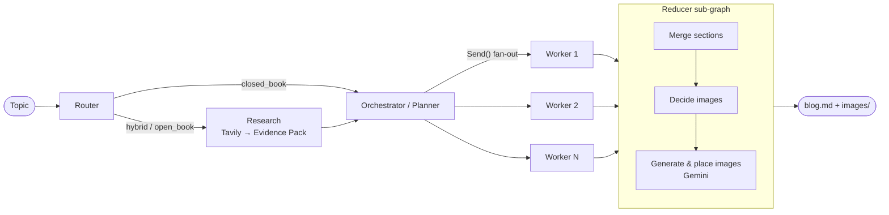

# ✍️ AI Blog Writing Agent

A **planning agent** that researches and writes complete technical blogs — with citations and AI‑generated diagrams — using an **Orchestrator–Worker** architecture built on **LangGraph**.

> Type a topic → the agent decides whether it needs the internet, researches it, plans the blog, writes every section **in parallel**, merges them, and adds images.

---

## 🧠 Architecture



| Stage | Node | What it does | Tech |
|---|---|---|---|
| 1 | **Router** | Classifies the topic as **Closed Book** (evergreen, no research), **Hybrid** (benefits from current examples) or **Open Book** (news / time-sensitive) and writes targeted search queries. | Groq / Gemini / OpenAI + Pydantic structured output |
| 2 | **Research** | Runs all queries in parallel on Tavily (news mode + recency window for open-book), de-duplicates, then an LLM curates an **Evidence Pack** (`title, url, snippet, published_at`). URLs not returned by Tavily are dropped → no hallucinated sources. | Tavily, Pydantic |
| 3 | **Orchestrator** | The brain. Produces a **Plan object**: title, audience, tone, blog kind, global constraints and 5–8 **tasks** (section title, goal, bullets, target words, `requires_code`, `requires_citations`). | Groq / Gemini / OpenAI |
| 4 | **Workers** | `Send()` **fans out** one worker per task; they run **in parallel** and each writes one Markdown section following the plan, citing only evidence URLs. Results fan back in via an `operator.add` reducer on state. | LangGraph `Send` |
| 5 | **Reducer** (sub-graph) | **Merge** sections in order + add References → **Decide images** (LLM picks where diagrams help and writes prompts, inserts `[[IMAGE_n]]` placeholders) → **Generate images** with Gemini, save to `outputs/<run>/images/`, replace placeholders with real paths. | LangGraph sub-graph, Gemini |
| UI | **Streamlit** | Live step-by-step progress, rendered blog with images, plan/evidence inspector, Markdown + ZIP downloads, past-blog history. | Streamlit |

Everything degrades gracefully: no Tavily key → closed-book writing; no Gemini key → blog without images.

---

## 📁 Project structure

```
blog_agent/
├── config.py          # Settings (keys/models) passed via LangGraph config, not env → safe for shared deploys
├── schemas.py         # Pydantic models (RouterDecision, EvidencePack, Plan, Task, ImagePlan) + graph State
├── prompts.py         # System prompts for every node
├── llm.py             # ChatOpenAI + structured-output helpers
├── utils.py           # slugify, evidence formatting, placeholder insertion
├── graph.py           # Main StateGraph wiring
└── nodes/
    ├── router.py
    ├── research.py
    ├── orchestrator.py  # planner + fan_out (Send)
    ├── worker.py
    └── reducer.py       # merge → decide_images → generate_images sub-graph
app.py                 # Streamlit frontend
main.py                # CLI
```

Each run is saved to `outputs/<timestamp>-<slug>/` containing `blog.md`, `images/`, `plan.json`, `evidence.json`, `meta.json`.

---

## 🚀 Run locally

```bash
git clone https://github.com/BhavyaSharma321/ai-blog-writing-agent.git
cd ai-blog-writing-agent
python -m venv .venv
# Windows: .venv\Scripts\activate   |   macOS/Linux: source .venv/bin/activate
pip install -r requirements.txt
cp .env.example .env        # then fill in your keys
streamlit run app.py
```

Or from the terminal:

```bash
python main.py "How LangGraph's Send API enables parallel agents" --words 1200
```

### API keys

The writing LLM can be **Groq**, **Google Gemini** or **OpenAI** (all via their OpenAI-compatible APIs). You need at least one.

| Key | Needed for | Get it |
|---|---|---|
| `GROQ_API_KEY` | Writing LLM (default `llama-3.3-70b-versatile`) | https://console.groq.com/keys |
| `GOOGLE_API_KEY` | Image generation + optional writing LLM (`gemini-2.5-flash`) | https://aistudio.google.com/apikey |
| `OPENAI_API_KEY` | Optional writing LLM (`gpt-4o-mini`) | https://platform.openai.com/api-keys |
| `TAVILY_API_KEY` | Optional – web research | https://app.tavily.com |

Pick the provider with `LLM_PROVIDER` (or in the sidebar). Keys can come from `.env`, `.streamlit/secrets.toml`, or be typed into the sidebar.

---|---|---|
| `OPENAI_API_KEY` | **Required** – routing, planning, writing | https://platform.openai.com/api-keys |
| `TAVILY_API_KEY` | Optional – web research | https://app.tavily.com |
| `GOOGLE_API_KEY` | Optional – image generation | https://aistudio.google.com/apikey |

Keys can come from `.env`, `.streamlit/secrets.toml`, or be typed into the sidebar.

---

## ☁️ Deploy on Streamlit Community Cloud

1. Push this repo to GitHub.
2. Go to https://share.streamlit.io → **Create app** → pick the repo, branch `main`, main file `app.py`.
3. **Advanced settings** → Python 3.12 → paste your secrets (see `.streamlit/secrets.toml.example`).
4. Deploy 🎉

---

## 🛠️ Tech stack

LangGraph · LangChain · Groq / Gemini / OpenAI · Tavily · Google Gemini (image) · Pydantic · Streamlit
